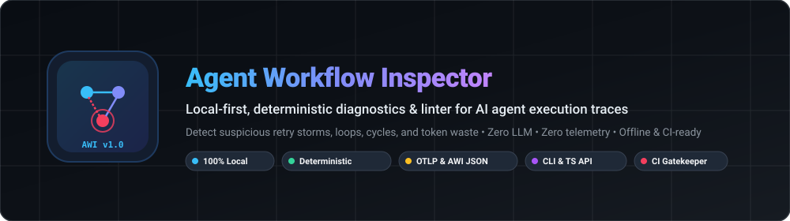
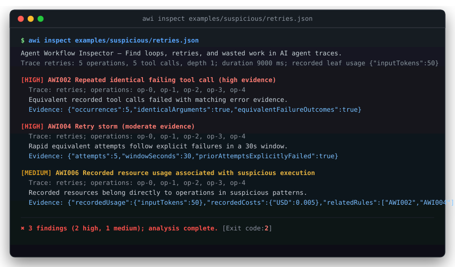
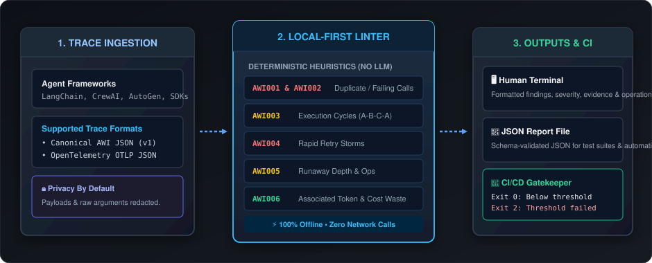
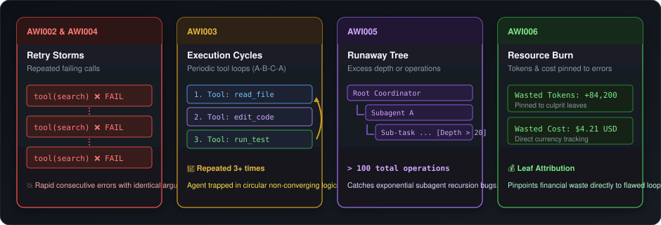

# Agent Workflow Inspector (AWI)

<p align="center">
  
</p>

<p align="center">
  <a href="https://github.com/jigar48/awi/releases"></a>
  <a href="https://nodejs.org"></a>
  <a href="https://github.com/jigar48/awi/actions"></a>
  <a href="LICENSE"></a>
  
  
  <a href="https://buymeacoffee.com/buildwithjigar"></a>
</p>

**Local-first, deterministic linter and diagnostics for AI agent execution traces.**

Agent Workflow Inspector (AWI) is an offline developer tool and CI gatekeeper that detects suspicious retry storms, repeated failing tool calls, non-converging execution cycles, runaway delegation trees, and resource burn in AI agent traces.

It reads versioned AWI JSON or OpenTelemetry (OTLP) JSON exports and emits deterministic evidence for local developer review or automated CI pipelines. Analysis requires **no accounts, no cloud services, no LLM API keys, no network access, and zero telemetry**.

---

<p align="center">
  
</p>

---

## Why AWI?

Autonomous agents and LLM-powered workflows are prone to silent execution bugs: an agent might retry a broken search query five times in 3 seconds, get trapped in a circular loop between two editing tools, or spawn recursive child tasks that run away with token budgets.

| Challenge with Traditional Observability                                                                                          | The AWI Approach                                                                                                                              |
| --------------------------------------------------------------------------------------------------------------------------------- | --------------------------------------------------------------------------------------------------------------------------------------------- |
| **Expensive LLM Judges**: Cloud evaluators use LLMs to evaluate LLMs, incurring high API costs and latency.                       | **Deterministic & Instant**: Pure computational heuristics analyze 50,000 operations in milliseconds with zero LLM API costs.                 |
| **Cloud-Only & Telemetry Heavy**: Platforms require streaming sensitive agent prompts and customer data to external SaaS servers. | **100% Local & Privacy-Preserving**: Runs completely on your machine or inside air-gapped CI. Sensitive tool payloads are omitted by default. |
| **Probabilistic Results**: The same trace analyzed twice by an LLM evaluator can yield different answers.                         | **100% Reproducible**: Exact mathematical algorithms ensure identical inputs always yield identical reports.                                  |
| **Difficult CI Integration**: Flaky external webhooks and latency make automated PR gating challenging.                           | **Native CI Exit Codes**: Returns `0` (clean), `1` (syntax/limits error), or `2` (findings over threshold) for seamless pipeline gating.      |

---

## Architecture & How It Works

AWI operates as a streamlined three-stage pipeline designed for memory safety, strict recursion limits, and zero external side effects:

<p align="center">
  
</p>

1. **Ingestion & Normalization**:
   - Parses canonical AWI JSON or OpenTelemetry OTLP JSON traces.
   - Enforces strict memory budgets (up to 16 MiB per file, 64 MiB total, depth limits) against adversarial or corrupt trace files.
   - Maps spans into parent-child operation timelines while projecting out generic model spans.
   - Computes deterministic parameter fingerprints while stripping sensitive payload arguments.

2. **Deterministic Detection Engine**:
   - Segments non-overlapping, timed sibling tool invocations under each parent.
   - Runs 6 purpose-built heuristic detectors (AWI001 through AWI006) to identify repetition, retry storms, execution cycles, graph explosion, and resource waste.

3. **Outputs & Gating**:
   - **Terminal Human Format**: High-contrast, colorized terminal summary highlighting rule IDs, implicated operation IDs, and specific evidence.
   - **Structured JSON**: Complete, schema-validated report file ready for automated analytics and test assertions.
   - **Pipeline Exit Codes**: Acts as an automated quality gate for GitHub Actions, GitLab CI, or pre-commit hooks.

---

## Detection Rules & Heuristics

AWI analyzes structural execution patterns. Findings indicate suspicious behavioral patterns, separating observed evidence from explanatory heuristics:

<p align="center">
  
</p>

| Rule ID    | Default Severity | Pattern Detected                | Default Condition                                            | Why It Matters                                                                          |
| ---------- | ---------------- | ------------------------------- | ------------------------------------------------------------ | --------------------------------------------------------------------------------------- |
| **AWI001** | `medium`         | Repeated identical tool call    | 4 equivalent calls within a bounded 100-call window          | Redundant operations, caching misses, or unmemoized retrieval.                          |
| **AWI002** | `high`           | Repeated identical failing call | 3 equivalent failures with matching error payload            | Broken external integrations, expired credentials, or unchanging bad arguments.         |
| **AWI003** | `medium`         | Execution cycle                 | Periodic sequence of 2–6 tool calls repeating 3 times        | Non-converging agent loops (e.g., `read` → `edit` → `test` → `read` → `edit` → `test`). |
| **AWI004** | `high`           | Rapid retry storm               | 5 equivalent attempts in a 30s window after explicit failure | Aggressive, unbacked retry loops hammering downstream APIs.                             |
| **AWI005** | `medium`         | Runaway trace complexity        | > 100 total operations or parent depth > 20                  | Runaway recursive subagent delegation or infinite planning trees.                       |
| **AWI006** | `medium`         | Resource burn on faulty calls   | Implicated leaf operations with recorded usage or cost       | Direct financial and token waste attributed to faulty loops.                            |

> [!NOTE]
> Findings are heuristics, not proof of bugs. Intentional polling loops, exponential backoff sequences, or idempotent retries may trigger rules depending on thresholds. AWI does not infer agent intent from timestamps.

---

## Installation & Quick Start

### Installation

Version 1.0.0 is currently a release candidate. Once published to npm, install globally:

```sh
npm install --global agent-workflow-inspector@1.0.0
```

To run directly via `npx`:

```sh
npx agent-workflow-inspector@1.0.0 inspect trace.json
```

### Run from Source

Requires **Node.js 22.18+ (22.x), 24.11+ (24.x), or 26.x** and **pnpm 11.25.0**:

```sh
git clone https://github.com/jigar48/awi.git
cd awi
pnpm install --frozen-lockfile
pnpm check
```

Inspect the included sample traces:

```sh
# Clean healthy trace (exits 0)
node dist/cli/index.js inspect examples/healthy/basic.json

# Suspicious retry storm (exits 2)
node dist/cli/index.js inspect examples/suspicious/retries.json

# OpenTelemetry OTLP format
node dist/cli/index.js inspect examples/opentelemetry/tools.json --input-format otel
```

---

## CLI Reference

### Command Syntax

```sh
awi inspect <paths...> [options]
```

### Options

| Flag             | Argument                              | Description                                                     | Default  |
| ---------------- | ------------------------------------- | --------------------------------------------------------------- | -------- |
| `--format`       | `human` \| `json`                     | Output presentation format.                                     | `human`  |
| `--input-format` | `auto` \| `awi` \| `otel`             | Input parser mode. `auto` detects format from root structure.   | `auto`   |
| `--fail-on`      | `low` \| `medium` \| `high` \| `none` | Minimum finding severity that causes exit code 2.               | `high`   |
| `--output`       | `<path>`                              | Write structured report to a new file (existing files refused). | none     |
| `--config`       | `<path>`                              | Path to custom `awi.config.json` threshold configuration.       | none     |
| `--show-content` | none                                  | Include recorded message/payload content (with key redaction).  | disabled |
| `--no-color`     | none                                  | Disable terminal ANSI color codes.                              | disabled |
| `-V, --version`  | none                                  | Display version number.                                         |          |
| `-h, --help`     | none                                  | Display CLI help.                                               |          |

### Exit Codes

| Exit Code | Meaning               | Details                                                                                            |
| --------- | --------------------- | -------------------------------------------------------------------------------------------------- |
| **`0`**   | Clean / Passing       | Analysis completed; no findings met or exceeded the `--fail-on` severity threshold.                |
| **`1`**   | Operational Error     | Invalid CLI arguments, unreadable files, corrupt JSON, or exceeded input size/depth limits.        |
| **`2`**   | Lint Threshold Failed | Analysis succeeded, but one or more findings met or exceeded the configured `--fail-on` threshold. |

---

## Trace Formats

### 1. Canonical AWI JSON Format

A minimal valid canonical trace file:

```json
{
  "version": 1,
  "traceId": "research-agent-run-42",
  "operations": [
    {
      "id": "op-001",
      "type": "tool",
      "name": "fetch_web_page",
      "arguments": { "url": "https://example.com/api" },
      "status": "error",
      "error": {
        "code": "HTTP_500",
        "message": "Internal Server Error"
      },
      "startTime": "2026-10-19T10:00:00.000Z",
      "endTime": "2026-10-19T10:00:01.500Z",
      "usage": {
        "inputTokens": 45,
        "outputTokens": 0
      },
      "cost": {
        "currency": "USD",
        "amount": 0.00045
      }
    }
  ]
}
```

### 2. OpenTelemetry (OTLP) Traces

AWI natively parses standard OpenTelemetry `tracesData.resourceSpans` JSON exports. It automatically maps:

- `spanId` → `operation.id`
- `parentSpanId` → `operation.parentId`
- Span attributes (`gen_ai.tool.name`, `rpc.method`, etc.) → `operation.name`
- Span status (`STATUS_CODE_ERROR`) → `operation.status`
- Timestamps from nanoseconds to ISO strings.

Specify `--input-format otel` or let AWI automatically detect the schema.

---

## TypeScript Library API

AWI exports an ESM library for embedding deterministic trace auditing directly into your TypeScript or JavaScript services:

```ts
import { readFile } from 'node:fs/promises';
import { analyze, ingest, parseJson } from 'agent-workflow-inspector';

// 1. Read and safely parse trace JSON
const rawContent = await readFile('trace.json', 'utf8');
const traces = ingest(parseJson(rawContent));

// 2. Run deterministic analysis with custom rules
const report = analyze(traces, {
  rules: {
    AWI001: { threshold: 5 },
    AWI004: { windowSeconds: 20 },
  },
  failOn: 'medium',
});

// 3. Inspect findings
for (const finding of report.findings) {
  console.log(
    `[${finding.severity.toUpperCase()}] ${finding.ruleId}: ${finding.title}`,
  );
  console.log(`  Implicated operations: ${finding.operationIds.join(', ')}`);
  console.log(`  Evidence:`, finding.evidence);
}

if (!report.passed) {
  console.error(
    `Quality gate failed with ${report.summary.findingsCount} findings.`,
  );
}
```

---

## CI / CD Integration

Use AWI in GitHub Actions to stop buggy agent updates from entering production:

```yaml
name: AI Agent Trace Audit

on:
  pull_request:
    branches: [main]
  push:
    branches: [main]

jobs:
  audit-agent-traces:
    runs-on: ubuntu-latest
    steps:
      - uses: actions/checkout@v4

      - uses: actions/setup-node@v4
        with:
          node-version: '24'

      - name: Install AWI
        run: npm install --global agent-workflow-inspector@1.0.0

      - name: Inspect Test Traces
        run: awi inspect ./test-traces --fail-on high --format human --output awi-report.json
```

---

## Configuration (`awi.config.json`)

Customize detection sensitivities using a strict configuration file:

```json
{
  "version": 1,
  "rules": {
    "AWI001": { "enabled": true, "threshold": 4 },
    "AWI002": { "enabled": true, "threshold": 3 },
    "AWI003": { "enabled": true, "minRepetitions": 3, "maxCycleLength": 6 },
    "AWI004": { "enabled": true, "threshold": 5, "windowSeconds": 30 },
    "AWI005": { "enabled": true, "maxOperations": 100, "maxDepth": 20 },
    "AWI006": { "enabled": true }
  },
  "fingerprint": {
    "ignorePaths": ["timestamp", "requestId", "metadata.nonce"]
  }
}
```

Apply with:

```sh
awi inspect traces/ --config awi.config.json
```

---

## Documentation

- [Getting started](docs/getting-started.md)
- [Trace formats & OTLP mapping](docs/trace-formats.md)
- [Detection rules reference](docs/detection-rules.md)
- [Configuration options](docs/configuration.md)
- [Architecture & design decisions](docs/architecture.md)
- [Security & privacy model](docs/security.md)
- [CI/CD integration guide](docs/ci-integration.md)
- [Report JSON schema](docs/report-schema.md)
- [Troubleshooting](docs/troubleshooting.md)
- [Known limitations](docs/limitations.md)
- [Verification record](docs/verification.md)
- [Contributing guide](CONTRIBUTING.md)
- [Release notes (v1.0.0)](docs/releases/v1.0.0.md)

---

## License

[MIT](LICENSE) © 2026 Jigar Prajapati.

---

## About the author

Built by **Jigar Prajapati**, freelance software developer and automation engineer in Ahmedabad, India (Python, Playwright, FastAPI, AWS, e-commerce platforms, AI agents).

- GitHub: [github.com/jigar48](https://github.com/jigar48)
- Portfolio: [jigar48.github.io/automatewithjigar](https://jigar48.github.io/automatewithjigar/)
- LinkedIn: [Jigar Prajapati](https://www.linkedin.com/in/buildaiwith-jigar-prajapati/)

## Support my work

If awi saves you time, you can buy me a coffee.

<a href="https://buymeacoffee.com/buildwithjigar"></a>
